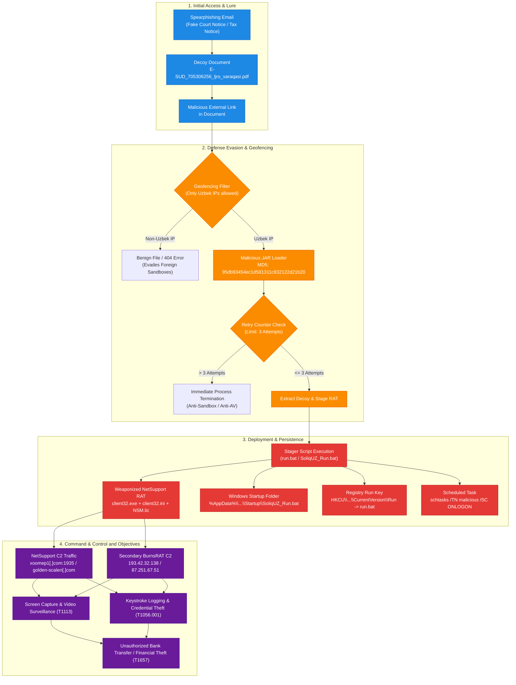
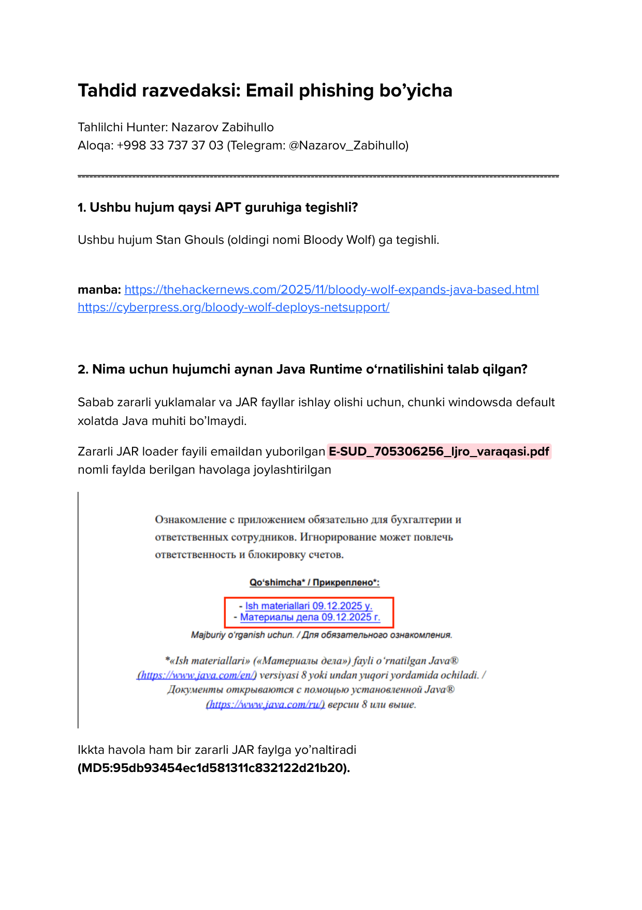
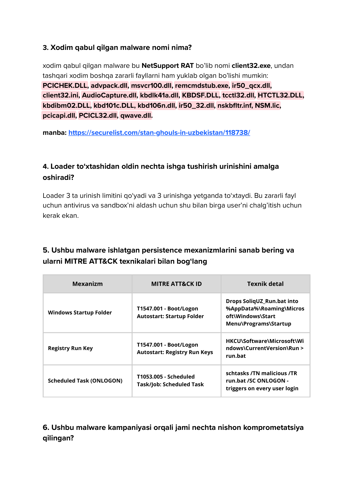
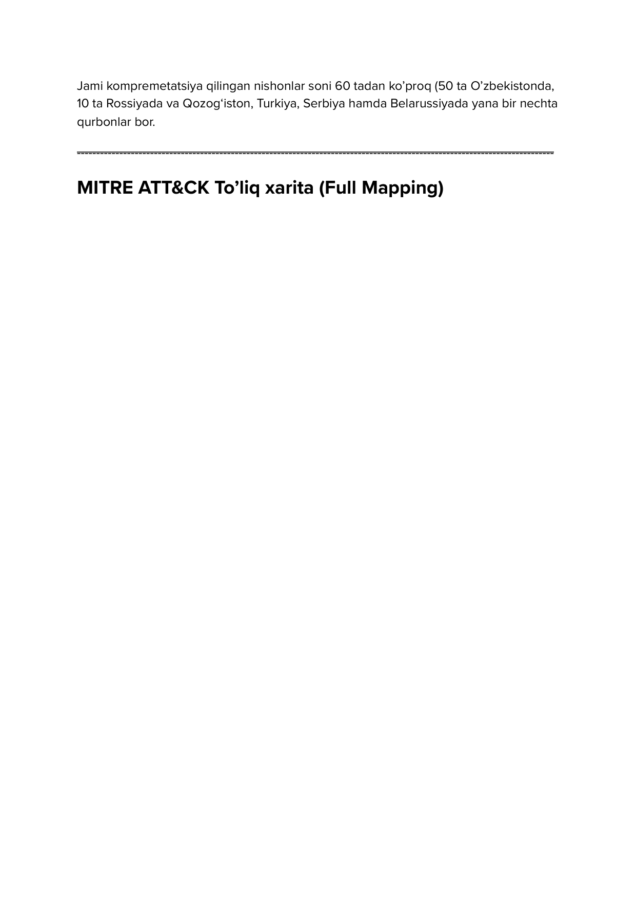
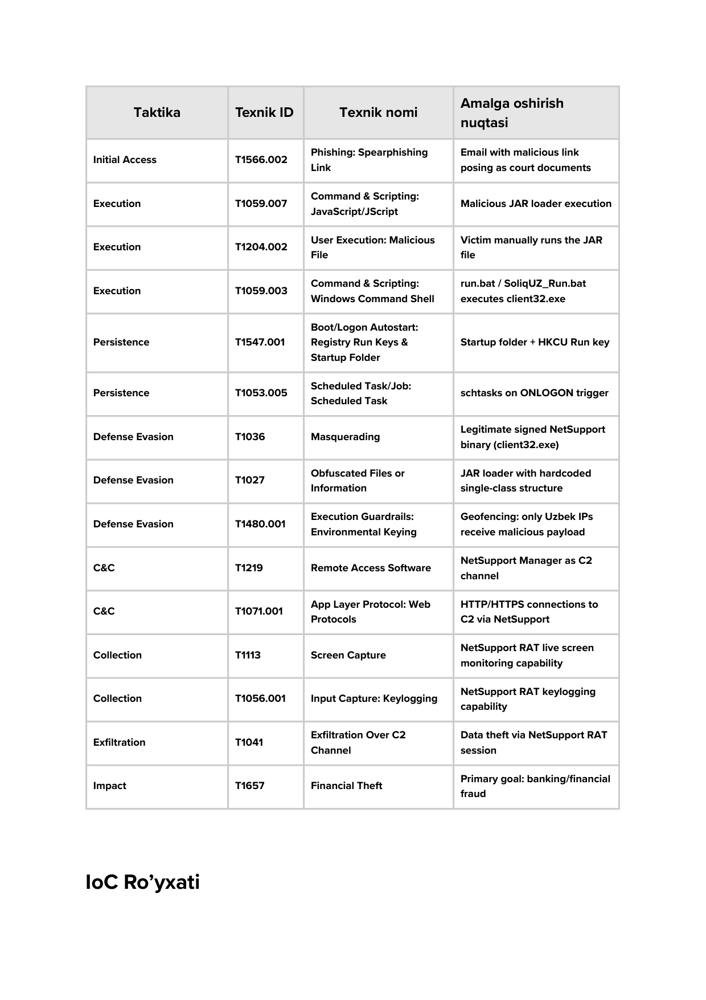
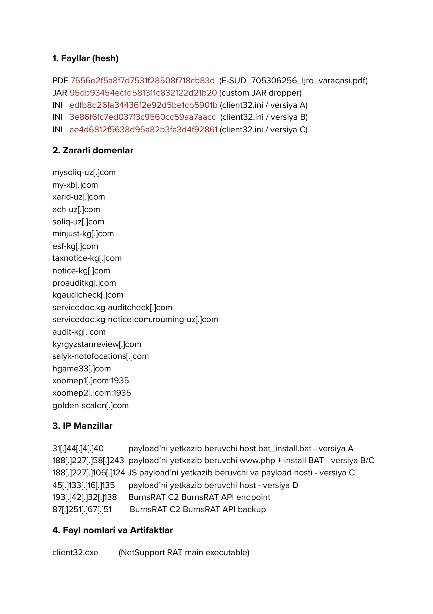
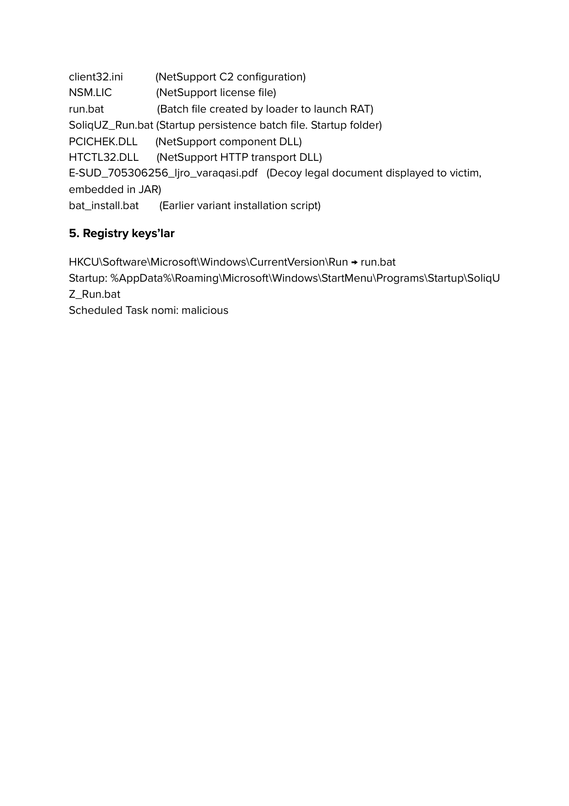

<div align="center">

# 🦅 Cyber Threat Intelligence Report
### APT Campaign Analysis: Stan Ghouls (Bloody Wolf)
**Targeting Uzbekistan & Central Asia via Weaponized NetSupport RAT**

[](https://securelist.com/stan-ghouls-in-uzbekistan/118738/)
[](https://www.cisa.gov/tlp)
[](https://github.com)
[](https://attack.mitre.org/software/S0648/)
[](https://attack.mitre.org/)
[](LICENSE)

<br/>

**Lead Threat Intelligence Analyst:** **Nazarov Zabihullo**  
📞 **Phone:** `+998 33 737 37 03` &nbsp;|&nbsp; 💬 **Telegram:** [@Nazarov_Zabihullo](https://t.me/Nazarov_Zabihullo)

---

### [📄 Download Full PDF Report](./Threat_Intelligence_Report.pdf) &nbsp;•&nbsp; [📊 MITRE Navigator Layer](./docs/mitre_attack_navigator_layer.json) &nbsp;•&nbsp; [🛡️ Detection Rules](./detections/) &nbsp;•&nbsp; [🎯 STIX 2.1 Bundle](./iocs/stix2_stan_ghouls.json)

</div>

---

## 📑 Table of Contents
1. [Executive Summary](#-executive-summary)
2. [Threat Actor Profile](#-threat-actor-profile)
3. [Cyber Kill Chain & Attack Architecture](#-cyber-kill-chain--attack-architecture)
4. [Deep-Dive Technical Analysis](#-deep-dive-technical-analysis)
5. [MITRE ATT&CK Enterprise Matrix Mapping](#-mitre-attck-enterprise-matrix-mapping)
6. [Indicators of Compromise (IoCs)](#-indicators-of-compromise-iocs)
7. [Detection Engineering & Threat Hunting](#-detection-engineering--threat-hunting)
8. [SOC Playbook & Mitigation Strategies](#-soc-playbook--mitigation-strategies)
9. [Report Visual Showcase](#-report-visual-showcase)
10. [Repository Structure](#-repository-structure)

---

## 🎯 Executive Summary

In this threat intelligence investigation, we dissect a highly targeted cyber espionage and financial crime campaign orchestrated by the threat actor **Stan Ghouls** (previously tracked across international threat feeds as **Bloody Wolf**). 

The campaign systematically targeted over **60 organizations** across Central Asia and Eastern Europe, with over **80% of victims concentrated in Uzbekistan (50+ targets)**, alongside infections in Kyrgyzstan, Kazakhstan, Russia, Turkey, Serbia, and Belarus.

### Key Highlights:
- **Primary Vector:** Spearphishing emails carrying a decoy court summons document titled `E-SUD_705306256_ljro_varaqasi.pdf`, impersonating the Uzbek judicial system (`E-SUD`).
- **Environmental Geofencing:** The adversary implemented IP-based environmental keying (`T1480.001`), ensuring that malicious payload delivery occurs exclusively when requests originate from Uzbek IP addresses.
- **Weaponized Commercial Tooling:** Hijacked legitimate, cryptographically signed remote management software (**NetSupport Manager RAT** - `client32.exe`) backed by secondary **BurnsRAT** command and control channels.
- **Persistence Redundancy:** Implemented a resilient triple-layer persistence model combining Windows Startup folder scripts (`SoliqUZ_Run.bat`), Registry Run keys (`HKCU\...\Run`), and scheduled tasks triggered `ONLOGON`.
- **Ultimate Objective:** Credential harvesting, live desktop monitoring, and unauthorized interbank financial theft (`T1657`).

> 📝 **O'zbekcha qisqacha ma'lumot:** Ushbu tahlil O'zbekiston davlat va xususiy sektoriga qaratilgan "Stan Ghouls" (Bloody Wolf) APT guruhining kiberhujumini to'liq fosh qiladi. Hujumchilar soxta sud ijro varaqasi (E-SUD) va Soliq qo'mitasi nomidan foydalanib, NetSupport RAT zararkunandasini tarqatgan. Hisobotda hujumning to'liq zanjiri, MITRE ATT&CK xaritasi, IoC ro'yxati, YARA va Sigma qoidalari taqdim etilgan.

---

## 👤 Threat Actor Profile

| Attribute | Intelligence Detail |
|---|---|
| **Actor Identifier** | **Stan Ghouls** (Former alias: **Bloody Wolf**) |
| **Suspected Origin / Focus** | Financially motivated cybercrime syndicate specializing in Central Asian infrastructure |
| **Primary Motivation** | Financial Theft (`T1657`), Business Email Compromise, Banking Fraud |
| **Target Geography** | **Uzbekistan** (Primary), Kyrgyzstan, Kazakhstan, Russia, Turkey, Serbia, Belarus |
| **Target Verticals** | Government, Judiciary, State Tax Services, Accounting/Financial Departments, Public Procurement |
| **Associated Malware** | Custom JAR Dropper, NetSupport RAT (`client32.exe`), BurnsRAT backdoor |
| **Intelligence Sources** | [The Hacker News](https://thehackernews.com/2025/11/bloody-wolf-expands-java-based.html) • [CyberPress](https://cyberpress.org/bloody-wolf-deploys-netsupport/) • [Kaspersky Securelist](https://securelist.com/stan-ghouls-in-uzbekistan/118738/) |

---

## 🔄 Cyber Kill Chain & Attack Architecture



---

## 🔬 Deep-Dive Technical Analysis

### 1. Mandatory Java Runtime Requirement
Standard modern Windows installations do not ship with Java Runtime Environment (JRE) by default. The threat actor engineered their spearphishing delivery around this requirement:
- The lure document instructed the victim that viewing the signed enforcement notice required the latest official Java module.
- Once installed, the victim manually executed the malicious JAR file (`MD5: 95db93454ec1d581311c832122d21b20`), bypassing standard `.exe` browser download blocking policies.

### 2. Execution Loop Counter (Anti-Sandbox / Anti-AV Evasion)
The custom JAR loader incorporates an internal run-counter mechanism:
- The loader limits itself to **exactly 3 execution attempts**.
- If execution conditions or environmental checks fail after 3 retries, the process gracefully self-terminates without detonating the payload.
- **Analyst Note:** This counter-measure is explicitly crafted to confound automated multi-pass dynamic analysis sandboxes and confuse incident responders during triage.

### 3. Environmental Keying / Geofencing (`T1480.001`)
The adversary's C2 staging servers enforce strict Geo-IP blacklisting. Only client IP ranges assigned to Uzbek internet service providers (such as Uztelecom, Sarkor, TPS, etc.) receive the active RAT installer scripts (`bat_install.bat`, `www.php`). Automated crawlers from international cloud vendors (AWS, Azure, GCP) receive inert HTTP responses.

### 4. Multi-Vector Persistence Architecture
To guarantee survival across reboots and logoff events, the loader installs three independent persistence mechanisms simultaneously:

| Mechanism | MITRE ID | Technical Implementation |
|---|---|---|
| **Windows Startup Folder** | `T1547.001` | Drops `SoliqUZ_Run.bat` into `%AppData%\Roaming\Microsoft\Windows\Start Menu\Programs\Startup\` |
| **Registry Run Key** | `T1547.001` | Sets `HKCU\Software\Microsoft\Windows\CurrentVersion\Run` with value `run.bat` |
| **Scheduled Task** | `T1053.005` | Executes: `schtasks /TN malicious /TR run.bat /SC ONLOGON` (triggers on every user session logon) |

---

## 🗺️ MITRE ATT&CK Enterprise Matrix Mapping

| Tactic | Technique ID | Technique Name | Implementation in Campaign | Detection & Hunt Strategy |
|---|---|---|---|---|
| **Initial Access** | [`T1566.002`](https://attack.mitre.org/techniques/T1566/002/) | Spearphishing Link | Phishing emails delivering links posing as judicial summons (`E-SUD`) | Email gateway link inspection & quarantine of `.jar` downloads |
| **Execution** | [`T1204.002`](https://attack.mitre.org/techniques/T1204/002/) | User Execution: Malicious File | Victim lured into opening external JAR archive | Endpoint telemetry monitoring `javaw.exe` invocation |
| **Execution** | [`T1059.007`](https://attack.mitre.org/techniques/T1059/007/) | JavaScript / JScript | Staging scripts (`www.php`, JS variant C payload delivery) | Script block logging (EID 4104) & web proxy inspection |
| **Execution** | [`T1059.003`](https://attack.mitre.org/techniques/T1059/003/) | Windows Command Shell | Batch files (`run.bat`, `SoliqUZ_Run.bat`) launching `client32.exe` | Sysmon EID 1 (Process Creation: `cmd.exe` executing scripts) |
| **Persistence** | [`T1547.001`](https://attack.mitre.org/techniques/T1547/001/) | Boot/Logon Autostart: Registry Run Keys | Modifies `HKCU\Software\Microsoft\Windows\CurrentVersion\Run` | Sysmon EID 13 (Registry value set) / Defender KQL |
| **Persistence** | [`T1547.001`](https://attack.mitre.org/techniques/T1547/001/) | Boot/Logon Autostart: Startup Folder | Drops `SoliqUZ_Run.bat` in user Startup folder | File integrity monitoring in user `%AppData%` Startup tree |
| **Persistence** | [`T1053.005`](https://attack.mitre.org/techniques/T1053/005/) | Scheduled Task/Job: Scheduled Task | Executes `schtasks /TN malicious /TR run.bat /SC ONLOGON` | Sysmon EID 1 / Windows Security EID 4698 (Task creation) |
| **Defense Evasion** | [`T1036`](https://attack.mitre.org/techniques/T1036/) | Masquerading | Legitimate signed NetSupport binary `client32.exe` hijacked as RAT | Detect `client32.exe` running outside legitimate install paths |
| **Defense Evasion** | [`T1027`](https://attack.mitre.org/techniques/T1027/) | Obfuscated Files or Information | Single-class obfuscated JAR loader hiding dropped assets | YARA scanning on incoming archives in temp folders |
| **Defense Evasion** | [`T1480.001`](https://attack.mitre.org/techniques/T1480/001/) | Execution Guardrails: Environmental Keying | Geofencing validation: payload delivered only to Uzbek IPs | Network threat intelligence correlation against C2 staging |
| **Command & Control** | [`T1219`](https://attack.mitre.org/techniques/T1219/) | Remote Access Software | NetSupport Manager protocol utilized for persistent remote access | Firewall blocking of non-business NetSupport client traffic |
| **Command & Control** | [`T1071.001`](https://attack.mitre.org/techniques/T1071/001/) | Application Layer Protocol: Web Protocols | HTTP/HTTPS and custom port 1935 connections to adversary C2 | Outbound port filtering and Zeek/Suricata protocol parsing |
| **Collection** | [`T1113`](https://attack.mitre.org/techniques/T1113/) | Screen Capture | Real-time surveillance of victim display and financial portals | EDR behavioral heuristics for active screen-grabbing APIs |
| **Collection** | [`T1056.001`](https://attack.mitre.org/techniques/T1056/001/) | Input Capture: Keylogging | Built-in NetSupport keystroke logging capturing passwords/keys | Monitor hook installation (`SetWindowsHookEx`) by `client32` |
| **Exfiltration** | [`T1041`](https://attack.mitre.org/techniques/T1041/) | Exfiltration Over C2 Channel | Sensitive financial documents and tokens transmitted over C2 | Network DLP monitoring abnormal outbound upload spikes |
| **Impact** | [`T1657`](https://attack.mitre.org/techniques/T1657/) | Financial Theft | Unauthorized funds transfer via corporate online banking systems | Real-time banking fraud analytics & dual-authorization enforcement |

> 💡 **Visual Matrix:** Import the ready-to-use layer file [`docs/mitre_attack_navigator_layer.json`](./docs/mitre_attack_navigator_layer.json) into the [MITRE ATT&CK Navigator](https://mitre-attack.github.io/attack-navigator/) to interact with the full matrix view.

---

## 🚨 Indicators of Compromise (IoCs)

*All indicators have been defanged (`[.]`) to ensure safe documentation.*

### 1. Cryptographic File Hashes (MD5)
| File Type | MD5 Hash | Filename / Identifier | Role / Context |
|---|---|---|---|
| **PDF** | `7556e2f5a8f7d7531f28508f718cb83d` | `E-SUD_705306256_ljro_varaqasi.pdf` | Decoy judicial enforcement summons |
| **JAR** | `95db93454ec1d581311c832122d21b20` | `loader.jar` (Custom Dropper) | Obfuscated 3-try Java dropper |
| **INI** | `edfb8d26fa34436f2e92d5be1cb5901b` | `client32.ini` (Variant A) | NetSupport RAT C2 configuration file |
| **INI** | `3e86f6fc7ed037f3c9560cc59aa7aacc` | `client32.ini` (Variant B) | NetSupport RAT C2 configuration file |
| **INI** | `ae4d6812f5638d95a82b3fa3d4f92861` | `client32.ini` (Variant C) | NetSupport RAT C2 configuration file |

### 2. Malicious Infrastructure (Domains)
```text
# Spoofed Uzbek Government, Tax & Financial Services
mysoliq-uz[.]com
soliq-uz[.]com
my-xb[.]com
xarid-uz[.]com
ach-uz[.]com
servicedoc.kg-notice-com.rouming-uz[.]com

# Spoofed Kyrgyz Republic Public Services & Audits
minjust-kg[.]com
esf-kg[.]com
taxnotice-kg[.]com
notice-kg[.]com
proauditkg[.]com
kgaudicheck[.]com
servicedoc.kg-auditcheck[.]com
audit-kg[.]com
kyrgyzstanreview[.]com
salyk-notofocations[.]com

# C2 Servers & Payload Delivery Gateways
hgame33[.]com
xoomep1[.]com:1935
xoomep2[.]com:1935
golden-scalen[.]com
```

### 3. Adversary IP Addresses
| IP Address | Geolocation | Role & Operational Function |
|---|---|---|
| `31[.]44[.]4[.]40` | Staging Host | Payload delivery host (`bat_install.bat` - Variant A) |
| `188[.]227[.]58[.]243` | Staging Host | Payload delivery host (`www.php` + install BAT - Variant B/C) |
| `188[.]227[.]106[.]124` | Staging Host | JavaScript payload delivery & payload hosting - Variant C |
| `45[.]133[.]16[.]135` | Staging Host | Payload delivery host - Variant D |
| `193[.]42[.]32[.]138` | C2 Node | **BurnsRAT** Primary C2 API endpoint |
| `87[.]251[.]67[.]51` | C2 Node | **BurnsRAT** Backup C2 API endpoint |

### 4. Host Artifacts & Dropped Files
```text
client32.exe        # NetSupport RAT main executable (hijacked legitimate binary)
client32.ini        # NetSupport C2 client gateway configuration
NSM.lic             # NetSupport commercial license token
run.bat             # Batch launcher spawned by JAR loader
SoliqUZ_Run.bat     # Startup folder persistence masquerading as State Tax service
PCICHEK.DLL         # NetSupport core support library
HTCTL32.DLL         # NetSupport HTTP transport network module
bat_install.bat     # Staging installation script (earlier campaign variant)
```

### 5. Persistence Registries & Task Configurations
```text
Registry Run Key:   HKCU\Software\Microsoft\Windows\CurrentVersion\Run -> "run.bat"
Startup Path:       %AppData%\Roaming\Microsoft\Windows\Start Menu\Programs\Startup\SoliqUZ_Run.bat
Scheduled Task:     schtasks /TN malicious /TR run.bat /SC ONLOGON
```

> 💾 **Download IoC Datasets:** Ingest ready-to-use feeds directly into your SIEM/TIP:
> - **[CSV Format](./iocs/iocs.csv)** — Delimiter-separated feed for firewall/EDR import.
> - **[JSON Format](./iocs/iocs.json)** — Machine-readable threat feed with metadata.
> - **[STIX 2.1 Bundle](./iocs/stix2_stan_ghouls.json)** — OASIS STIX 2.1 standard bundle for MISP, OpenCTI, and TAXII.

---

## 🛡️ Detection Engineering & Threat Hunting

### 1. YARA Detection Rule
Deploy this rule on file servers, email attachments, and endpoint quarantine pipelines:

```yara
rule APT_StanGhouls_NetSupport_Campaign {
    meta:
        author = "Nazarov Zabihullo (@Nazarov_Zabihullo)"
        description = "Detects Stan Ghouls artifacts, lure references, and NetSupport C2 parameters"
        threat_actor = "Stan Ghouls / Bloody Wolf"
        reference = "https://securelist.com/stan-ghouls-in-uzbekistan/118738/"
        tlp = "CLEAR"

    strings:
        $decoy_pdf   = "E-SUD_705306256_ljro_varaqasi.pdf" ascii wide nocase
        $bat_startup = "SoliqUZ_Run.bat" ascii wide nocase
        $schtask_cmd = "schtasks /TN malicious /TR run.bat /SC ONLOGON" ascii wide nocase
        $ns_client   = "client32.exe" ascii wide nocase
        $ns_ini      = "client32.ini" ascii wide nocase
        $c2_gateway  = "Gateway=" ascii wide nocase
        $c2_node1    = "xoomep1.com" ascii wide nocase
        $c2_node2    = "golden-scalen.com" ascii wide nocase

    condition:
        $decoy_pdf or
        $bat_startup or
        $schtask_cmd or
        ($ns_client and $ns_ini and $c2_gateway) or
        (any of ($c2_node*))
}
```
*Full rule file available at [`detections/yara/apt_stan_ghouls_netsupport_rat.yar`](./detections/yara/apt_stan_ghouls_netsupport_rat.yar).*

---

### 2. Sigma Detection Rule (Process Creation)
Converts automatically to Splunk, Microsoft Sentinel, Elastic, and QRadar:

```yaml
title: Suspicious NetSupport Client Execution - Stan Ghouls Campaign
id: d7a12b48-18e3-4c91-95c2-f12b84931a01
status: production
description: Detects client32.exe executed from user AppData or launched via script interpreters.
author: Nazarov Zabihullo
tags:
    - attack.execution
    - attack.t1059.003
    - attack.defense_evasion
    - attack.t1036
logsource:
    category: process_creation
    product: windows
detection:
    selection_image:
        Image|endswith: '\client32.exe'
    selection_parent:
        ParentImage|endswith:
            - '\cmd.exe'
            - '\powershell.exe'
            - '\javaw.exe'
            - '\java.exe'
    selection_path:
        Image|contains:
            - '\AppData\Roaming\'
            - '\AppData\Local\Temp\'
    condition: selection_image and (selection_parent or selection_path)
level: high
```
*Full rule collection available in [`detections/sigma/`](./detections/sigma/).*

---

### 3. Microsoft Sentinel / Defender KQL Hunting Query

```kql
// Hunt for NetSupport RAT execution and Stan Ghouls persistence scripts
let MaliciousBatches = dynamic(["run.bat", "SoliqUZ_Run.bat", "bat_install.bat"]);
DeviceProcessEvents
| where (FileName =~ "client32.exe" and FolderPath has_any ("AppData", "Temp", "Roaming"))
        or (FileName =~ "cmd.exe" and ProcessCommandLine has_any (MaliciousBatches))
        or (FileName =~ "schtasks.exe" and ProcessCommandLine has "malicious" and ProcessCommandLine has "ONLOGON")
| project Timestamp, DeviceName, AccountName, FileName, FolderPath, ProcessCommandLine, InitiatingProcessFileName
| sort by Timestamp desc
```

> 🔍 **Additional Hunting Queries:** Detailed SPL, KQL, and EQL queries are provided in [`detections/hunting/hunting_queries.md`](./detections/hunting/hunting_queries.md).

---

## 🛠️ SOC Playbook & Mitigation Strategies

```
             ┌────────────────────────────────────────────────────────┐
             │       INCIDENT RESPONSE TRIAGE WORKFLOW                │
             └──────────────────────────┬─────────────────────────────┘
                                        │
           ┌────────────────────────────┴───────────────────────────┐
           ▼                                                        ▼
  [Immediate Containment]                                 [Eradication & Recovery]
  1. Isolate infected host from network                   1. Kill active client32.exe tasks
  2. Block C2 IPs & Domains at firewall/DNS               2. Delete registry key HKCU\...\Run
  3. Revoke active corporate banking sessions             3. Remove SoliqUZ_Run.bat from Startup
  4. Reset domain user & financial portal credentials     4. Delete scheduled task 'malicious'
```

### Strategic Defense Recommendations:
1. **Email Security Policy:** Block inbound emails containing `.jar`, `.bat`, `.cmd`, or password-protected archives containing script objects. Implement sandboxing with residential Geo-IP proxies to bypass adversary geofencing.
2. **Application Control (AppLocker / WDAC):** Restrict `client32.exe` and untrusted binaries from executing out of `%AppData%`, `%LocalAppData%`, and `%Temp%` directories.
3. **Endpoint Auditing:** Ensure PowerShell Script Block Logging (Event ID 4104), Process Creation auditing (Event ID 4688 with command lines), and Sysmon are actively ingested into your SIEM.
4. **Awareness & Simulation:** Conduct targeted spearphishing simulation drills educating accounting personnel to authenticate court orders exclusively on the official portal [`https://esud.sud.uz`](https://esud.sud.uz).

---

## 📸 Report Visual Showcase

Here is a visual overview of the original 6-page comprehensive Threat Intelligence Report:

<div align="center">

| Page 1: Threat Actor & Initial Access | Page 2: Malware & Persistence |
|---|---|
|  |  |

| Page 3: Target Scope & Mapping | Page 4: Full MITRE ATT&CK Breakdown |
|---|---|
|  |  |

| Page 5: Indicators of Compromise | Page 6: Host Artifacts & Registries |
|---|---|
|  |  |

</div>

---

## 📂 Repository Structure

```text
├── README.md                                  # Executive & Technical dossier (You are here)
├── Threat_Intelligence_Report.pdf             # Original 6-page Canva PDF Report
├── LICENSE                                    # Creative Commons Attribution 4.0 International
├── assets/                                    # High-resolution page renders and diagrams
│   ├── report_page_1.png
│   ├── report_page_2.png
│   ├── report_page_3.png
│   ├── report_page_4.png
│   ├── report_page_5.png
│   └── report_page_6.png
├── iocs/                                      # Structured Threat Intelligence Feeds
│   ├── iocs.csv                               # SIEM/EDR ready-to-ingest CSV
│   ├── iocs.json                              # Structured JSON IoC feed
│   └── stix2_stan_ghouls.json                 # OASIS STIX 2.1 Threat Intel Bundle
├── detections/                                # Actionable Detection Engineering
│   ├── yara/
│   │   └── apt_stan_ghouls_netsupport_rat.yar # Production YARA rules
│   ├── sigma/
│   │   ├── proc_creation_win_netsupport_client32.yml
│   │   ├── registry_run_win_stan_ghouls_persistence.yml
│   │   └── schtask_creation_win_stan_ghouls_onlogon.yml
│   └── hunting/
│       └── hunting_queries.md                 # Splunk SPL, Microsoft Sentinel KQL, EQL
└── docs/
    ├── EXECUTIVE_SUMMARY.md                   # C-Level Strategic Brief
    └── mitre_attack_navigator_layer.json      # MITRE ATT&CK Navigator Layer
```

---

<div align="center">

### 👨‍💻 Author & Contact

**Nazarov Zabihullo**  
*Cyber Threat Intelligence (CTI) & SOC Analyst*  

[](https://t.me/Nazarov_Zabihullo)
[](tel:+998337373703)

*If this threat intelligence research is valuable to your security operations, please star ⭐ this repository!*

</div>
